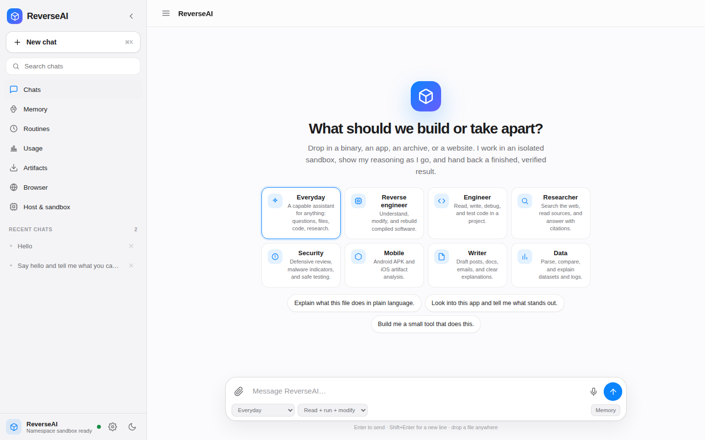
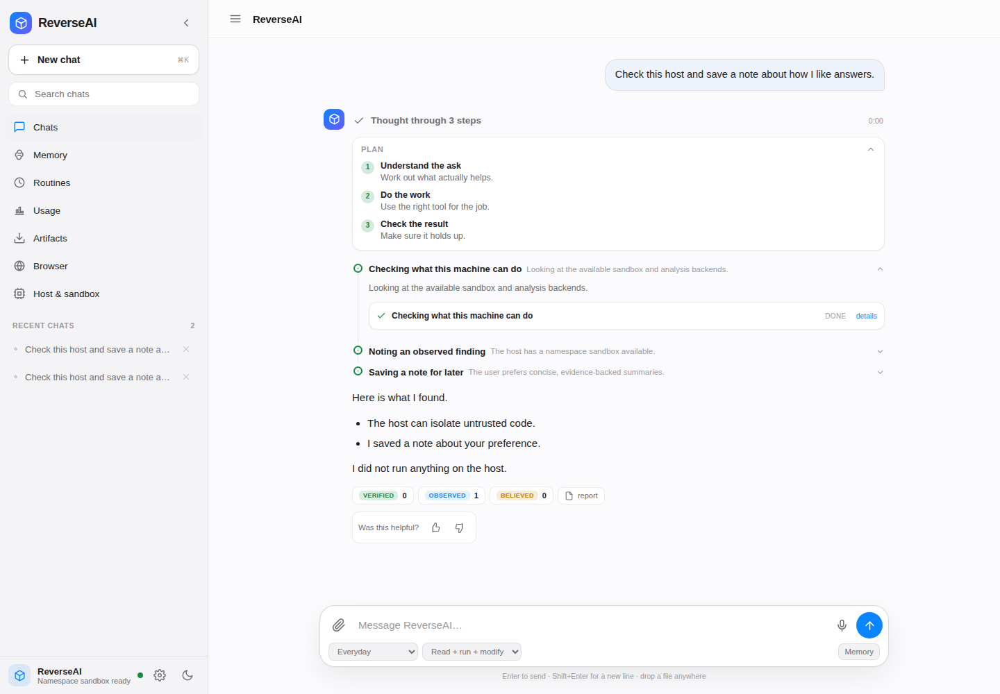
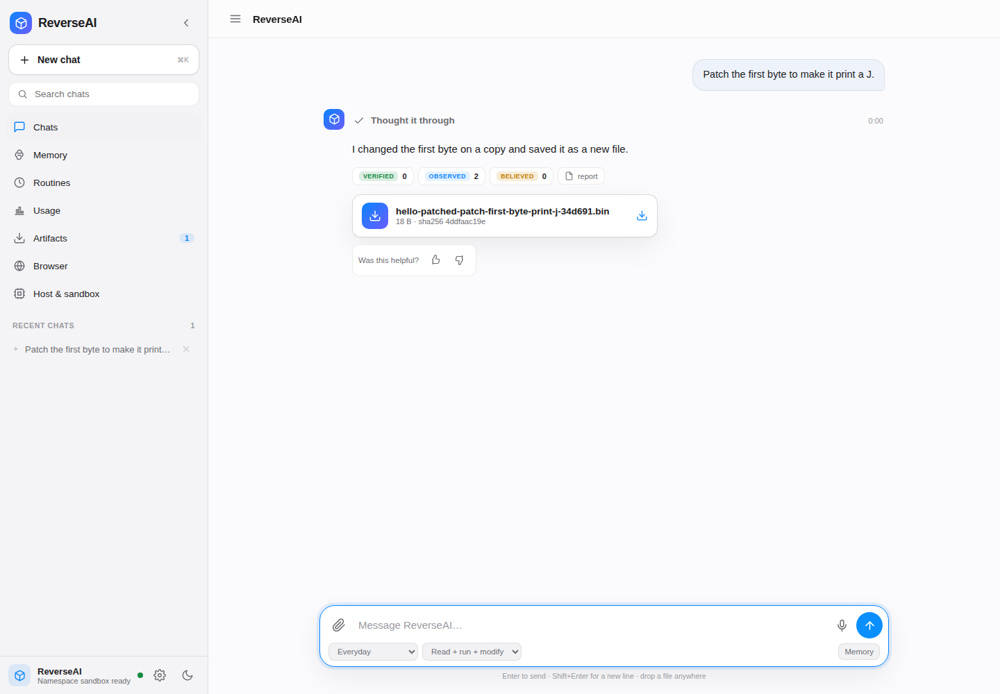
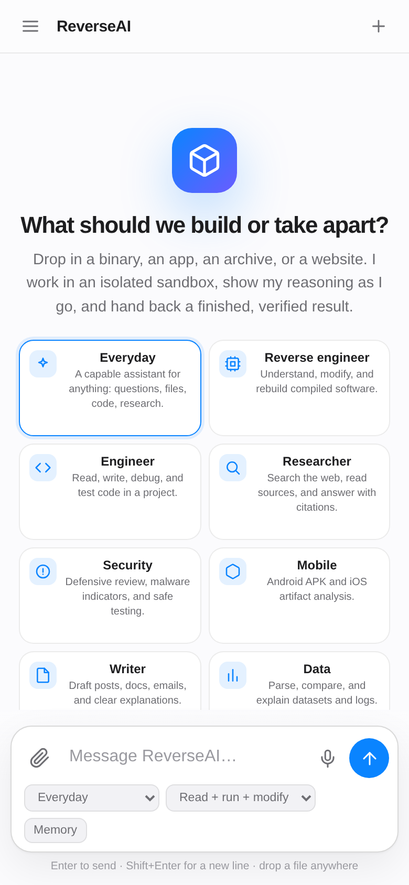
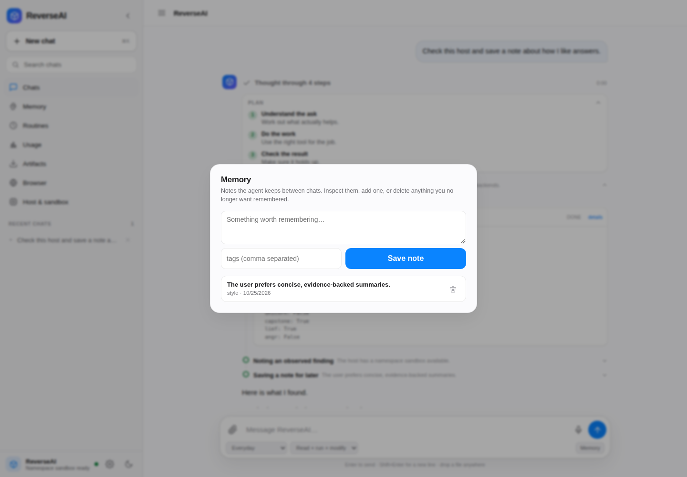
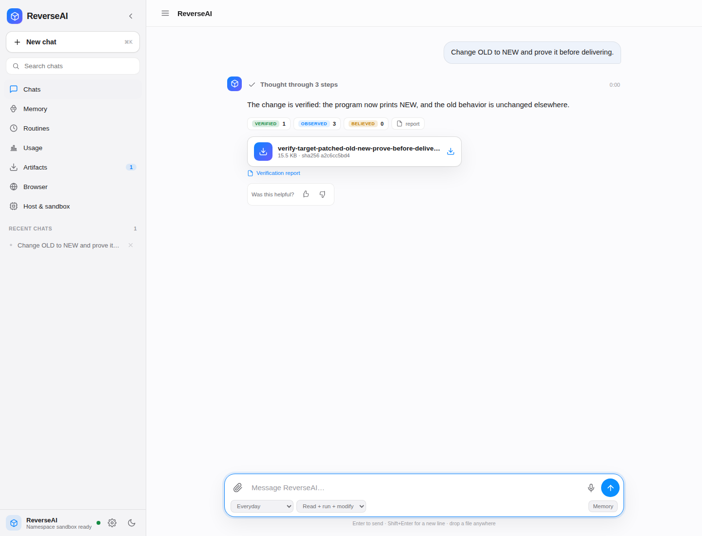
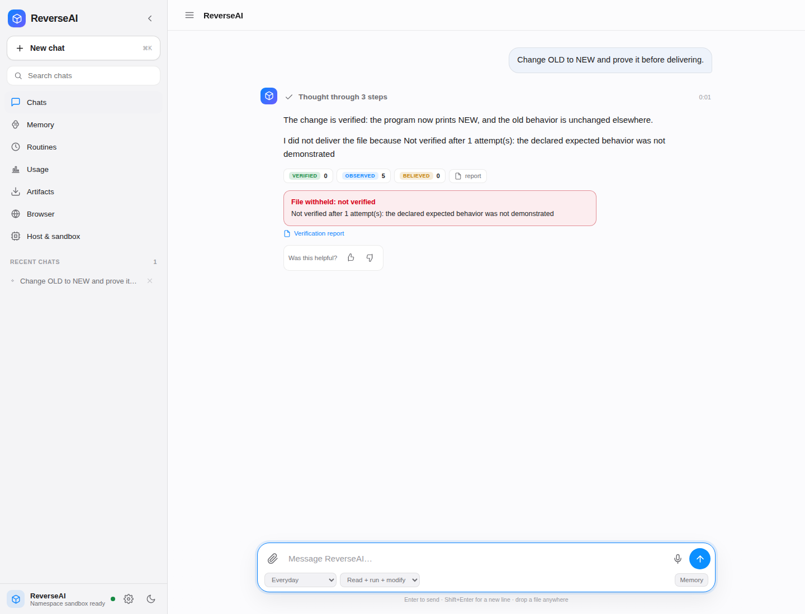

<p align="center">
  
</p>

<h1 align="center">ReverseAI</h1>

<p align="center"><b>Understand. Modify. Rebuild.</b></p>

<p align="center">
  An autonomous engineering agent for compiled software and live websites.<br>
  Drop in a binary, an app, an archive, or a URL. Say what you want in plain language.<br>
  Watch it plan, reason, use real tools, test in a hardened sandbox, and hand back a verified result.
</p>

<p align="center">
  <a href="LICENSE"></a>
  
  
  
  
  <a href="https://maykano-dev.github.io/Reverse-AI/"></a>
</p>

<p align="center">
  <a href="https://maykano-dev.github.io/Reverse-AI/">Live site</a> ·
  <a href="#quick-start">Quick start</a> ·
  <a href="#whats-new-in-090">What's new</a> ·
  <a href="docs/UI_SURFACES.md">Interactive surfaces</a> ·
  <a href="docs/UNIFIED_AGENT.md">Feature map</a> ·
  <a href="docs/POWER.md">Power map</a> ·
  <a href="docs/INTELLIGENCE_ROADMAP.md">Intelligence roadmap</a> ·
  <a href="docs/TESTING.md">Testing and evaluation</a> ·
  <a href="docs/AUDIT_REMEDIATION.md">Audit remediation</a> ·
  <a href="docs/DANGEROUS_AND_OPEN_ITEMS.md">Dangerous surfaces</a> ·
  <a href="docs/AUDIT_0_8_0.md">0.8.0 audit</a> ·
  <a href="docs/VERIFYING.md">Reproducible verification</a> ·
  <a href="#deploy-it">Deploy</a> ·
  <a href="docs/SECURITY.md">Security</a> ·
  <a href="CHANGELOG.md">Changelog</a>
</p>

---

## Why it is different

Most "AI + reverse engineering" demos stop at describing a binary. ReverseAI closes the loop: it reads the real bytes, reasons about them, **changes** them, and **proves the change works** in a sandbox before you ever see the result.

- **Evidence over inference.** The analysis layer reports only what it parsed. Guesses are a separate, labeled layer. Findings are tiered **believed → observed → verified**. A modified binary is **withheld** unless a declared behavioral test passes in the sandbox.
- **A build is not a fix.** A patch that compiles, launches, or "looks right" is not delivered. Differential tests compare the original and the candidate across real inputs; unexpected regressions block delivery.
- **A visible, natural thought process.** A plan, a short reasoning timeline, tool cards with real output, sources, and evidence. No raw tool names, no "investigating" boilerplate.
- **Untrusted by default.** Analysis is pure. Execution happens only inside a hardened bubblewrap sandbox (no network, dropped capabilities, read-only system, tmpfs workdir) and is refused when nothing can contain it.
- **A real working memory.** Durable notes, web research with citations, scheduled routines, specialist agents, and conversations that survive a reload or a server restart.
- **Mobile first.** A PWA that works as a full chat app on a phone, with a drawer, safe areas, touch-sized controls, and an installable manifest.

## What's new in 0.9.0

| Area | What landed |
|---|---|
| **Interactive surfaces** | The agent can create questions, forms, tables, charts, graphs, diffs, code views, progress panels, approval cards, file drops, and sandboxed custom views inside the conversation. Choices include an **Other - type your own** option. |
| **Surface actions** | Every surface records its interaction and can continue the same conversation with a structured decision. Surfaces persist in the Job and in archived chats. |
| **New visual system** | Warm neutral palette, serif welcome, compact sidebar, context header, calmer suggestion cards, a more spacious composer, smooth transitions, and mobile adjustments. |
| **Live preview** | Generated sites open in the Preview panel automatically, with a Preview card in the chat. The agent no longer says it cannot render a page. |
| **Images and decisions** | `web_images` finds real images across the web or Wikimedia Commons; `install_media` validates, installs, and records credit/license. Attachments and public URLs work too. Question, form, and approval surfaces pause until answered. |
| **Web resources** | `install_resource` installs remote stylesheets, web fonts, and SVG icons with validation. JavaScript is refused. |
| **Optional image inspection** | `inspect_image` can send a candidate image to an operator-configured multimodal endpoint to check the visible subject. Without configuration it fails honestly. |
| **Live browser preview** | Multi-tab browser with back/forward, reload, fullscreen, external open, and automatic reload for static sites. A gated bubblewrap-backed dev-server runner can start `npm run dev` or another command and open its loopback URL. |
| **Practical interaction** | Live progress, explicit risk on approvals, recommended options, evidence tables, and a real sandboxed escape hatch for custom views. |

## What's new in 0.8.0

| Area | What landed |
|---|---|
| **Desktop surface** | A local desktop-session broker and loopback listener. Allowlisted actions, bearer token, approval gate, audit. No VNC or keyboard/mouse injection backend is bundled. |
| **Telegram channel** | Bot API transport, chat allowlist, pairing, rate limits, read-only `/status`, `/jobs`, `/readiness`, `/discover`. No shell or payment command. |
| **Payments** | Intent ledger with idempotency, amount/currency limits, capability + scoped approval, and a deterministic mock provider. No card data and no live processor. |
| **MCP** | JSON-RPC client, manifest validation, tool allowlist, timeout, capability gate. Host-process transport is explicitly opt-in; tests use an in-memory transport. |
| **Hooks** | Signed manifests, event allowlist, sandboxed subprocess runner, timeout, environment isolation, audit. Disabled by default. |
| **Self-training** | Verified-trace extraction, redaction, deduplication, deterministic train/holdout split, and a benchmark-gated improvement pipeline. No automatic training or weight deployment. |
| **Self-deployment** | Deployment plans, dry run, scoped approvals, injected transport, explicit rollback. No cloud/SSH transport is bundled. |
| **Open items** | Differential fuzzing, PE resources/debug/TLS/rich header, Mach-O dylibs, Landlock/cgroup/QEMU surfaces, mission persistence, per-token quota, and a single readiness verdict. |

The details and honest statuses are in `docs/DANGEROUS_AND_OPEN_ITEMS.md`.

## What's new in 0.7.0

| Area | What landed |
|---|---|
| **Audit remediation** | A tracked checklist (`docs/AUDIT_REMEDIATION.md`) turns the audit into code and tests. |
| **Tool contracts** | Every one of the 50+ tools is called with empty arguments and must return a failing `ToolResult`, never a stack trace. The suite caught broken web-research imports and several partial-call crashes. |
| **CLI contracts** | Every command parses, `--help` works, and corpus → verify → report, approvals, repository mapping, and a mock agent round trip are tested. |
| **HTTP auth contracts** | Missing/wrong tokens return 401; `/world` and `/discover` enforce the same path allowlist as the rest of the API. |
| **Sandbox boundaries** | Tests prove the target cannot reach the network, read host files, inherit host secrets, or outlive its timeout. |
| **Mutation testing** | `assess_test_strength` mutates the candidate and reports whether the corpus detects breakage. Weak cases and surviving mutants are named. |
| **Benchmark v2** | Development and held-out tasks; metrics for verified success, regressions, repair success, false verification, refusal, cost, and time. `bench --list` and `--split`. |
| **Analysis depth** | Direct call/jump cross-references (`xrefs`, `find_xrefs`) and a repository-wide language/import/test/risk map (`repo`, `analyze_repository`). |
| **Repository audit** | `reverseai audit` checks version consistency, zero required dependencies, required assets, tool narration/UI labels, doc links, secret hygiene, and test presence. |
| **Persistent evidence** | Jobs and signed reports now carry the world-model summary, ranked opportunities, hypotheses, and mutation strength. |

## What's new in 0.6.0

| Area | What landed |
|---|---|
| **World model** | `build_world_model` turns a real target into components, sections, functions, dependencies, symbols, unresolved questions, and provenance. It persists and can be queried. |
| **Autonomous discovery** | `discover_opportunities` proposes hidden features, undocumented interfaces, architecture/dependency risks, missing tests, and unlockable capabilities. Every item has evidence, impact, effort, risk, confidence, and a next step. |
| **Experiment engine** | Hypothesis → experiment → prediction → controlled observation → update. Environment errors are not counted as evidence. Competing hypotheses are separated by discriminating tests, not votes. |
| **Causal and twin reasoning** | Causal predictions only travel through explicit mechanisms; correlations stay labeled as hypotheses. The digital twin predicts affected components and names what still needs a live test. |
| **Design search** | Architecture candidates are scored against weighted objectives and constraints, with a Pareto front and a measured benchmark. Algorithm optimization checks equivalence before claiming speedup. |
| **Tool forge** | A small tool can be written, tested in the sandbox, promoted only after every test passes, and listed with a manifest. |
| **Product and proof** | Specification-to-product planning, behavior contracts, proof packages (`proof.json` / `PROOF.md`), independent verification, calibrated confidence, and regression promotion. |
| **Orchestration** | Model router, universal tool manifests, capability measurement, mission control, budgets, trust tiers, the intelligence foundry, verified skill learning, analogy, and failure review. |
| **Five modes** | Ask, Build, Modify, Optimize, Autonomous Mission. The mode changes the contract with the user, not the safety rules. |
| **Domain contracts** | Hardware, robotics, CAD, network, security, and computer-operator adapters return inventory, hypotheses, a simulation plan, and explicit refusals. They do not claim physical or live-system capability. |

## What's new in 0.5.0

| Area | What landed |
|---|---|
| **Behavioral corpora** | `capture_behavior_corpus` records the original program's exit/stdout/stderr/output-file behavior by target SHA-256. Later changes can load it with `use_corpus`, so a regression on a previously observed input blocks delivery. |
| **Model-free verification** | `reverseai verify --original ... --modified ... --cases ... --report ...` runs the same proof without a model or API key. `reverseai report verify` checks the signature. |
| **Replay recipes** | Every signed report now includes the original and modified hashes, case names, and a copy-paste command to reproduce the verification. |
| **Workspace checkpoints** | Every modification snapshots the workspace first. Review a bounded diff, then restore. Symlinks, device nodes, absolute paths, and `..` are refused. |
| **Execution readiness** | `readiness` and `check_execution_readiness` say whether a target is executable here, emulated with a configured rootfs, or analysis-only. A PE/Mach-O on Linux is not promised as behaviorally verified. |
| **seccomp denylist** | bubblewrap now installs an x86_64 cBPF filter that blocks ptrace, namespace/mount escape, module loading, keyring, bpf, perf, io_uring, and similar attack-surface syscalls. The report records whether it was actually applied. |
| **Control-flow maps** | `cfg` and `build_control_flow_graph` produce bounded basic blocks, branch edges, call targets, and rough cyclomatic complexity. |
| **Approvals + gate** | Irreversible actions need a capability opt-in *and* a live, scoped, single-use HMAC approval. Every decision is audited. There is no ambient authority. |
| **Encrypted vault** | Optional Fernet vault with PBKDF2-HMAC-SHA256, mode 0600, deny-by-default capability, and no plaintext fallback. |

## What's new in 0.4.0

| Area | What landed |
|---|---|
| **Strategy selector** | Scores resource_edit, byte_patch, component_replace, rebuild, and reimplement from the real `AnalysisReport` plus the goal. Returns rationale, confidence, alternatives, warnings, and a clarifying question when the evidence is thin. |
| **Three modes** | Direct (resource edit, byte patch, component swap), Reconstruction (reimplement), Modernisation (rebuild or reimplement with new capabilities). The engine recommends a mode; the user can override it. The chosen mode is recorded on the Job. |
| **Modification planner** | An explicit ordered plan: investigate, locate components, estimate blast radius, implement, verify. Each step appears in the UI. Ambiguous requests return `needs_clarification` instead of guessing. |
| **Scoped changes** | "Change X, preserve everything else" identifies the relevant functions/sections/resources, then runs the intended-change cases plus regression cases over the rest. An unrelated behavior change blocks delivery. |
| **`plan_and_modify`** | The end-to-end WRITE tool: choose, plan, implement through the existing executors, verify through the Batch 1 repair loop, and record the signed report. |
| **Environment fingerprint** | Signed reports now record the sandbox backend, isolation level, network/filesystem controls, capability dropping, and seccomp status that were actually applied. |
| **High-risk capability policy** | Remote control, vault, payments, live workstation, persistent squads, MCP, and hooks are denied by default. Enabling any of them requires a master opt-in, a per-capability opt-in, and (for secrets) a vault key. |

## What's new in 0.3.0

| Area | What landed |
|---|---|
| **Verified delivery gate** | `verify_modification` runs a declared behavioral test in the sandbox. If it fails, the artifact is not delivered; there is no "trust me" path. The gate runs automatically before final delivery of any binary modification. |
| **Repair loop** | A failed test is fed back to the model, which proposes a new patch set; bounded to 3 attempts by default (`REVERSEAI_MAX_REPAIR_ATTEMPTS`, max 10). Every attempt appears in the reasoning timeline. |
| **Differential testing** | `differential_test` runs original and modified artifacts over an auto-generated or targeted input corpus, comparing exit code, stdout, stderr, and declared output files. Unexpected regressions are flagged. Sandbox stdin is supported. |
| **Signed verification reports** | Every job exposes `GET /jobs/<id>/report` (JSON) and `/report.html` (self-contained HTML) with the goal, change, evidence tiers, tests, differential summary, artifact SHA-256, and a deterministic signature. HMAC-SHA256 when `REVERSEAI_REPORT_KEY` is set, SHA-256 otherwise. |
| **Honest blocked state** | A blocked artifact is replaced by a plain-language reason in the chat and report. The model's optimistic draft is not allowed to stand as the conclusion. |

## What's new in 0.2.0

| Area | What landed |
|---|---|
| **Thinking UI** | Plan + chain-of-thought timeline, collapsible steps, tool cards, findings, elapsed time, and a real stop button (`POST /jobs/:id/cancel`). |
| **Natural narration** | Tool calls become specific human sentences ("Looking at the bytes around 0x400", "Running it in the sandbox"), never internal names or "investigating". |
| **Memory** | Durable notes (`remember`, `recall`, `forget`) in a human-editable JSON store, plus a Memory panel. |
| **Research with sources** | `web_search` and `web_read`, SSRF-guarded, with Source cards and citations. Optional SearXNG endpoint. |
| **Routines** | Daily, weekday, weekly, every-N-minutes, or one-off scheduled tasks, managed from the UI or a tool. |
| **Specialists** | Eight agent templates (Everyday, Reverse engineer, Engineer, Researcher, Security, Mobile, Writer, Data) and a `delegate` tool for squads. |
| **Durable turns** | Every event is appended to a replayable log; conversations persist across restarts; reconnecting resumes from where you left off. |
| **Usage + feedback** | Token/cost estimates, monthly budget gate, and thumbs up/down stored for improvement. |
| **Mobile + PWA** | Rewritten mobile-first UI, installable app shell, notifications, and speech input. |
| **Better artifacts** | Descriptive, unique names like `app-patched-remove-license-check-8f3a1c.exe`, with size and SHA-256 in the delivery card. |
| **Unlimited-OCR** | Optional adapter for Baidu's Unlimited-OCR behind vLLM/SGLang, with Tesseract as the zero-setup fallback. |
| **Security** | Optional bearer auth, path allowlists for public deployments, operator-controlled network egress, redirect-validated SSRF, and a browser-render gate. |
| **Packaging** | The UI, vendor scripts, and Ghidra script are included in the wheel. The CI/Pages workflows are staged in `docs/github-workflows/` until a token with the `workflow` scope can push them. |

<p align="center">
  
</p>

---

## Quick start

### The app

```bash
git clone https://github.com/maykano-dev/Reverse-AI.git
cd Reverse-AI

export DEEPSEEK_API_KEY=sk-...     # the model is configured server-side only
python3 -m reverseai serve         # open http://127.0.0.1:8077
```

No third-party packages are needed for the core. Python 3.11+ and standard binutils are enough. Optional libraries make it stronger:

```bash
pip install -e ".[enhanced]"       # lief, capstone, pyelftools
pip install -e ".[ocr]"            # pytesseract, pillow, pymupdf
pip install -e ".[vault]"          # cryptography for the optional encrypted vault
```

### CLI

```bash
# Static analysis of any PE / ELF / Mach-O binary
python3 -m reverseai analyze /usr/bin/objdump

# Structural diff between two binaries
python3 -m reverseai diff ./app ./app.patched

# Build an evidence-backed world model and discover opportunities
python3 -m reverseai world ./app --unresolved
python3 -m reverseai discover ./app --limit 8

# Cross-references and source-repository map
python3 -m reverseai xrefs ./app --function main
python3 -m reverseai repo ./project

# Repository invariants and benchmark inventory
python3 -m reverseai audit
python3 -m reverseai bench --list

# Inspect dangerous surfaces without enabling them
python3 -m reverseai surfaces --json
python3 -m reverseai mcp validate mcp.json
python3 -m reverseai hooks validate hook.json

# What can this host do (sandbox backends, emulators, optional libs)?
python3 -m reverseai caps

# Which high-risk capabilities are enabled? (all denied by default)
python3 -m reverseai capabilities

# Can this target be executed and verified here, or only analyzed?
python3 -m reverseai readiness ./sample

# Ask the agent to discover what nobody asked for
python3 -m reverseai agent run --mode autonomous \
  --goal "Investigate this system and tell me what is worth changing." \
  --target ./sample --permission read

# Basic-block and call graph
python3 -m reverseai cfg ./sample --functions 8

# Verify a modification without a model, and sign the result
python3 -m reverseai verify --original ./sample --modified ./sample.patched \
  --cases cases.json --report report.html

# Capture a durable regression corpus from the original
python3 -m reverseai corpus capture --target ./sample --cases smoke.json

# Check a signed report
python3 -m reverseai report verify report.json

# Run a command in the hardened sandbox
python3 -m reverseai sandbox run --untrusted -- /bin/echo "hello from the lab"

# Autonomous run
python3 -m reverseai agent run \
  --goal "Explain what this program does and verify it by running it." \
  --target ./sample --permission write --save ./jobs

# Capability benchmark
python3 -m reverseai bench run

# Tests (no network, no API key)
python3 -m unittest discover -s tests
```

### Docker

```bash
docker build -t reverseai .
docker run -p 8077:8077 \
  -e DEEPSEEK_API_KEY=sk-... \
  -e REVERSEAI_AUTH_TOKEN=choose-a-token \
  -v reverseai-data:/data \
  reverseai
```

The image runs as an unprivileged user and drops privileges via the entrypoint. `REVERSEAI_AUTH_TOKEN` is required before exposing it to the internet.

---

## Deploy it

[](https://render.com/deploy?repo=https://github.com/maykano-dev/Reverse-AI)

The included [`render.yaml`](render.yaml) creates a web service, a 1 GB data disk, and a health check. Set `DEEPSEEK_API_KEY` and `REVERSEAI_AUTH_TOKEN` in the dashboard. The app asks for the token on first load and then keeps it in the browser.

**Sandbox note.** Untrusted-code *execution* needs unprivileged user namespaces, which many PaaS hosts disable. On Render, analysis, chat, research, memory, routines, decompilation, and static website cloning all work; sandboxed execution is refused honestly. For full execution, use a VM/VPS that allows user namespaces. See [`docs/SECURITY.md`](docs/SECURITY.md) and [`docs/DEPLOY.md`](docs/DEPLOY.md).

---

## What it can do today

- **Analyze** PE / ELF / Mach-O (including fat/universal iOS), Android APK, and archives: headers, sections, entropy, imports/exports, DT_NEEDED, symbols, functions, strings, optional capstone disassembly, packer and malware indicators, and structural diff.
- **Decompile** to readable C through Ghidra headless (optional), with a Java script for modern Ghidra releases.
- **Modify autonomously** choose a strategy from the real analysis, plan the work, estimate blast radius, implement on a copy, and prove it. It supports Direct, Reconstruction, and Modernisation modes, and it asks instead of guessing when the request is ambiguous.
- **Modify + verify** byte patches and LIEF structural edits on a copy, then a declared behavioral test plus a differential corpus in the sandbox. A failed test withholds the artifact and can trigger a bounded repair attempt.
- **Scope a change** with "change X, preserve everything else": targeted cases prove the intended delta and regression cases prove the rest of the program still behaves.
- **Clone + rebuild websites** with a static fetch engine and an opt-in headless render engine, packaged as a working offline bundle with a clean-room guardrail.
- **Research** the web with sources, read primary pages, and keep citations attached to the answer.
- **Remember** stable preferences and decisions across chats.
- **Schedule** recurring work with routines that run while the server is up.
- **Delegate** to specialist agents (researcher, engineer, reverse engineer, reviewer, writer, data).
- **Read untrusted files safely** with bomb-safe extraction, malware indicators, and optional Unlimited-OCR or Tesseract.
- **Chat** in a stateful, multi-turn conversation. Follow-ups share the target, evidence, sources, and rebuilt artifacts.
- **Stay durable** when the tab closes: reopen and reattach to the live event stream.
- **Speak and listen** with browser speech input and optional spoken replies.
- **Install it** as a PWA on a phone or desktop.

<p align="center">
  
</p>

---

## The interface

| Desktop | Mobile |
|---|---|
|  |  |

The interface is deliberately opinionated:

- **Plan first**, then a compact reasoning timeline. Each step is collapsible and contains the tool output that justified it.
- **Evidence chips** separate `verified`, `observed`, and `believed`, and the full report is one click away.
- **Sources** are real cards with favicons, not a footer of naked URLs.
- **Artifacts** show the filename, size, and SHA-256, plus a link to the signed verification report. The original file is never changed.
- **Blocked deliveries** are explicit: the file is withheld, the reason is plain, and the report shows exactly what failed.
- **No internal names leak** into the conversation. The agent speaks like a person.

<p align="center">
  
</p>

---

## Supported targets

| Platform | Format | Analysis depth |
|---|---|---|
| Windows | PE (.exe/.dll) | header, sections, imports, exports, entropy, heuristics |
| Linux | ELF | header, sections, dynamic imports + DT_NEEDED, function recovery, native sandboxed execution |
| macOS / iOS | Mach-O (arm64/x86_64, fat) | header, segments/sections, symbols, functions |
| Android | APK | manifest hints, permissions, DEX, ABIs, native ELF libraries |
| Web | HTML/JS site | static fetch or optional headless render → offline bundle |

ELF runs natively in the sandbox. Foreign-platform binaries run through Qiling emulation when installed and configured, or a QEMU VM backend (designed, not wired).

---

## Architecture

```
User goal
  │
  ▼
Agent (agent/)  ── orchestrator · conversation · tool registry · mediator · evidence · job
  │
  ├── Providers (DeepSeek · OpenAI-compatible · Anthropic · Ollama · mock)
  ├── Memory · Skills · Templates · Routines · Research
  ├── Tools (analysis, execution, modification, coding, memory, research, delegate)
  │
  ├── Analysis core (core/)  PE · ELF · Mach-O · strings · disasm · heuristics · diff
  ├── Modification (modify/) byte patches · LIEF structural edits
  ├── Verification (verify/) behavioral regression in the sandbox
  ├── Sandbox (sandbox/) bubblewrap · subprocess · qiling
  │
  └── Service (server/) HTTP + SSE · durable event log · auth · PWA UI
```

The full design is in [`docs/ARCHITECTURE.md`](docs/ARCHITECTURE.md). The feature-by-feature map of what was unified from the agent products is in [`docs/UNIFIED_AGENT.md`](docs/UNIFIED_AGENT.md).

### Verification and reports

```
verify_modification  -> behavioral test(s) in the sandbox, optional repair loop
differential_test    -> corpus comparison, regression detection
GET /jobs/<id>/report       -> signed JSON
GET /jobs/<id>/report.html  -> self-contained HTML, no external calls
```

A modification is delivered only when `verify_modification` records at least one
passing expectation. The report includes the artifact SHA-256, mode, strategy,
plan steps, sandbox environment fingerprint, and every evidence tier. A failed
repair attempt leaves the file in the workspace but does not mark it delivered or
verified.

The autonomous path is:

```
choose_modification_strategy -> plan_and_modify -> apply_* -> verify_modification
                                                      -> signed report
```

`plan_and_modify` refuses to guess: it returns a clarifying question when the goal
is ambiguous, when no behavioral expectation is declared, or when a scoped change
has no regression inputs.

<p align="center">
  
</p>

<p align="center">
  
</p>

### How a turn works

1. **Intake.** The target is validated (size caps, symlink refusal). A conversation gets a persistent workspace.
2. **Plan.** The agent picks a template and publishes a short plan.
3. **Reason.** The model sees the system prompt, memory, skills, conversation, and tool specs.
4. **Act.** Each tool call goes through the mediator (permission tier, audit, exception containment). The UI receives a natural `reason` event before the result.
5. **Observe.** Tools append evidence at the right tier. Research appends sources. Every event is written to a durable log.
6. **Conclude.** The final answer, evidence summary, sources, usage, and artifact meta are streamed and saved.

---

## Optional power-ups

| Feature | Enable with | Notes |
|---|---|---|
| Decompilation | Ghidra + a compatible JDK | `REVERSEAI_GHIDRA`, `REVERSEAI_JDK` |
| Long-document OCR | `REVERSEAI_OCR_URL` | Baidu Unlimited-OCR behind vLLM/SGLang |
| Local OCR | `pip install -e ".[ocr]"` | Tesseract system package required |
| Emulation | `pip install qiling` + `REVERSEAI_QILING_ROOTFS` | For foreign-platform binaries |
| Richer search | `REVERSEAI_SEARCH_URL` | SearXNG-compatible JSON |
| Headless clone | `REVERSEAI_ALLOW_BROWSER_RENDER=1` | Off by default on shared hosts |
| Coding network | `REVERSEAI_ALLOW_CODING_NETWORK=1` | Off by default; operator decision |

---

## Configuration

| Variable | Purpose |
|---|---|
| `DEEPSEEK_API_KEY`, `DEEPSEEK_MODEL`, `DEEPSEEK_BASE_URL` | Default model provider |
| `REVERSEAI_PROVIDER` | `deepseek`, `openai`, `anthropic`, `ollama`, or `mock` |
| `REVERSEAI_AUTH_TOKEN` | Require a bearer token on every API call |
| `REVERSEAI_ALLOWED_ROOTS` | Colon-separated roots for file paths when auth is on (the store is always allowed) |
| `REVERSEAI_MONTHLY_BUDGET` | Pause paid models after this many USD |
| `REVERSEAI_MAX_REPAIR_ATTEMPTS` | Verification repair attempts (default 3, max 10) |
| `REVERSEAI_MAX_TOKENS` | Maximum model output per step (default 8192) |
| `REVERSEAI_ENABLE_DANGEROUS_CAPABILITIES` | Master opt-in for deferred high-risk capabilities (default off) |
| `REVERSEAI_APPROVAL_KEY` | HMAC key for short-lived action approvals (optional) |
| `REVERSEAI_VAULT_KEY` | Key material for the optional encrypted vault (optional) |
| `REVERSEAI_REPORT_KEY` | HMAC key for signed verification reports (optional) |
| `REVERSEAI_QILING_ROOTFS` | Rootfs for emulated foreign-platform execution (optional) |
| `REVERSEAI_SECCOMP` | Set `0` to disable the seccomp denylist (default on) |
| `REVERSEAI_UPLOAD_MAX_MB` | Upload ceiling (default 512 MiB) |
| `REVERSEAI_ALLOW_PREVIEW_SERVER` | Set `1` to allow the bubblewrap dev-server preview |
| `REVERSEAI_QUOTA_RUNS_PER_MONTH` | Per-token monthly run ceiling (0 = off) |
| `REVERSEAI_QUOTA_TOKENS_PER_MONTH` | Per-token monthly token ceiling (0 = off) |
| `REVERSEAI_QUOTA_COST_USD_PER_MONTH` | Per-token monthly cost ceiling (0 = off) |
| `REVERSEAI_QUOTA_FILE` | Quota ledger path (defaults to `<store>/quotas.json`) |
| `REVERSEAI_VISION_URL`, `REVERSEAI_VISION_MODEL` | Optional OpenAI-compatible multimodal endpoint for `inspect_image` |
| `REVERSEAI_VISION_API_KEY` | Optional vision endpoint key (falls back to `OPENAI_API_KEY`) |
| `REVERSEAI_STORE` | Job/event/conversation/artifact storage |
| `REVERSEAI_SEARCH_URL` | SearXNG-compatible research endpoint |
| `REVERSEAI_OCR_URL`, `REVERSEAI_OCR_MODEL` | Unlimited-OCR endpoint |
| `REVERSEAI_SKILLS` | Directory of markdown playbooks |
| `REVERSEAI_GHIDRA`, `REVERSEAI_JDK` | Decompiler locations |
| `REVERSEAI_QILING_ROOTFS` | Emulation rootfs |
| `REVERSEAI_ALLOW_BROWSER_RENDER` | Opt in to headless Chromium cloning |
| `REVERSEAI_ALLOW_CODING_NETWORK` | Opt in to network for `run_command` |

Copy [`.env.example`](.env.example) to `.env` for a local setup. Never commit it.

---

## Security and responsible use

- Analysis is pure and runs in-process with bounded parsers.
- Untrusted execution is refused unless bubblewrap (or another isolating backend) is available.
- The API optionally requires a bearer token; file paths are allowlisted when auth is on.
- Tool output, web pages, and memory are treated as **data, not instructions**.
- Previewed and cloned sites run in an opaque-origin iframe with no access to the app.
- Secrets are redacted from logs; the model key never reaches the browser.

Known gaps are listed honestly in [`docs/SECURITY.md`](docs/SECURITY.md): the sandbox still shares the host kernel, Ghidra runs on the host, Landlock/cgroup enforcement is detected but not yet applied, and multi-tenant isolation is not built. High-risk capabilities (desktop, Telegram, payments, MCP, hooks, self-training, deployment) are **gated surfaces**, not live authorities; they are denied by default and any irreversible action also requires the approval gate in `security/gate.py`. See [`docs/DANGEROUS_AND_OPEN_ITEMS.md`](docs/DANGEROUS_AND_OPEN_ITEMS.md) for what is enabled and what backend is still absent.

Use ReverseAI for interoperability, security research, debugging, recovering your own work, and authorized testing. Analyze and modify only software and sites you own or are authorized to work on.

---

## Tests

```bash
python3 -m unittest discover -s tests -v
```

The suite covers real PE/ELF/Mach-O parsing, bubblewrap isolation, archive bombs, the full agent loop with a mock provider, SSE replay, durable conversations, cancellation, memory, routines, research parsing, OCR (mocked HTTP), naming, auth, and path guards. No network or API key is required.

---

## Roadmap

See [`docs/ROADMAP.md`](docs/ROADMAP.md). The next meaningful steps are:

- seccomp/landlock and cgroup limits for the sandbox
- multi-tenant auth, quotas, and object storage for artifacts
- a Redis worker and Postgres job store for scale
- an optional Docker workstation with a live desktop (the Xiryn-style layer)
- MCP connectors, hooks, and shareable agent templates
- collecting verified traces and fine-tuning an in-house model

---

## Contributing

Contributions are welcome. Start with [`CONTRIBUTING.md`](CONTRIBUTING.md). Every capability ships with a test. Never run untrusted code outside the sandbox, and keep the evidence tiers honest.

If ReverseAI is useful to you, a star helps other people find it.

## License

Released under the [MIT License](LICENSE). Free to use, modify, and build on. Use it responsibly and only on software and sites you own or are authorized to work on.
